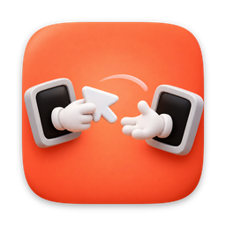

<p align="center">
  
</p>

<h1 align="center">Relay</h1>

<p align="center">
  <strong>Um teclado. Um trackpad. Mac e Windows como se fossem uma máquina só.</strong>
</p>

<p align="center">
  <a href="https://github.com/Jpecamargo/relay/releases/latest"></a>
  <a href="https://github.com/Jpecamargo/relay/actions/workflows/ci.yml"></a>
  
  
</p>

---

O Relay transforma o teclado e o trackpad do seu Mac no controle do seu PC Windows. Leve o cursor
até a borda da tela do MacBook e ele simplesmente continua no monitor do PC; o teclado vai junto,
com os atalhos que você já sabe de cor. Sem cabo extra, sem switch físico, sem streaming de vídeo:
cada tela continua mostrando o próprio computador, e o Relay só move o seu input entre eles.

## Por que o Relay

- **Uma mesa contínua.** MacBook e os monitores do PC viram um espaço só. Arraste as telas no editor
  para bater com a sua mesa — em milímetros, com ímã nas bordas — e o cursor atravessa exatamente
  onde as telas se encontram.
- **Feito para quem vive no Mac.** ⌘C, ⌘V, ⌘Tab, ⌘Q, ⌥←, ⌘⌫… funcionam no Windows como você espera:
  o Relay traduz os atalhos do Mac para os equivalentes do Windows, com exceções por aplicativo
  (no Windows Terminal, ⌘C copia e Ctrl+C continua interrompendo).
- **Latência que não se sente.** O movimento do mouse vai por UDP, um evento por pacote, em threads
  dedicadas — cerca de 60 µs de ida e volta em loopback. Em rede cabeada, o atraso é o da própria rede.
- **O PC na sua barra de menus.** Volume, mudo, mídia, bloquear, suspender, reiniciar, desligar e até
  ligar o PC (Wake-on-LAN), sem tirar a mão do Mac. CPU, RAM, GPU e temperatura do PC à vista.
- **Clipboard e arquivos sem fronteira.** Copie no Mac e cole no Windows — texto, rich text, imagens.
  Copie arquivos no Finder e cole no Explorer, ou arraste um arquivo da janela do Mac até o monitor do PC.
- **Som do PC no seu fone.** O áudio do Windows toca no Mac e o microfone do Mac vira o microfone do PC:
  Discord no PC, fone conectado no Mac.
- **Funciona onde outros param.** Um serviço do Windows leva o seu input até o prompt do UAC e a tela de
  bloqueio. E o caminho inverso também existe: o teclado e o mouse do PC podem controlar o Mac.
- **Privado por padrão.** Pareamento por código de 6 dígitos, todo o tráfego cifrado (Noise + ChaCha20-
  Poly1305), chaves no Keychain e no Credential Manager. Nada passa por servidor: é direto, na sua rede.

## Instalação

Baixe a versão mais recente em **[Releases](https://github.com/Jpecamargo/relay/releases/latest)**:

| Máquina | Arquivo |
|---|---|
| Mac com Apple Silicon (M1, M2, M3, M4) | `Relay_x.y.z_aarch64.dmg` |
| Mac com Intel | `Relay_x.y.z_x64.dmg` |
| PC Windows 10/11 (x64) | `Relay.Agent_x.y.z_x64-setup.exe` |

As atualizações chegam sozinhas: o Relay procura uma versão nova ao abrir e a cada 6 horas, mostra o
que mudou e só instala quando você clica em **Atualizar e reiniciar**.

> Os builds ainda não têm assinatura de desenvolvedor. No Mac, mova o Relay para Aplicativos e, na
> primeira abertura, use Ajustes do Sistema › Privacidade e Segurança › **Abrir mesmo assim**. No
> Windows, o SmartScreen pode avisar: **Mais informações › Executar assim mesmo**.

## Primeiros passos

1. **No PC:** abra o Relay Agent pelo ícone na bandeja. Ele mostra um código de 6 dígitos.
2. **No Mac:** clique no ícone do Relay na barra de menus › **Ajustes…** › **Conexão e pareamento**,
   escolha o PC na lista e digite o código. (Não apareceu? Informe o IP do PC no campo manual.)
3. Conceda ao Relay **Acessibilidade** e **Monitoramento de Entrada** quando o macOS pedir, e permita o
   acesso à rede local.
4. Em **Telas**, posicione os monitores do PC em volta do MacBook como estão na sua mesa.
5. Leve o cursor até a borda. Para voltar ao Mac a qualquer momento: **⌃⌥1**.

Requisitos: as duas máquinas na mesma rede local (cabo no PC é a melhor melhoria de latência) e, no
Windows, a rede marcada como **Privada**. Para usar o microfone do Mac no PC, instale o
[VB-CABLE](https://vb-audio.com/Cable/) no Windows (o som do PC no Mac não precisa de nada).

<details>
<summary><strong>Atalhos do Mac no Windows</strong></summary>

| No Mac | No Windows |
|---|---|
| ⌘ (sozinho) | Win (menu Iniciar) |
| ⌘Espaço | Win (busca) |
| ⌘C / ⌘V / ⌘X / ⌘Z | Ctrl+C / V / X / Z |
| ⇧⌘Z | Ctrl+Y |
| ⌘Tab | Alt+Tab |
| ⌘Q | Alt+F4 |
| ⌘← / ⌘→ | Home / End |
| ⌘↑ / ⌘↓ | Ctrl+Home / Ctrl+End |
| ⌥← / ⌥→ | Ctrl+← / Ctrl+→ |
| ⌘⌫ / ⌥⌫ | apagar até o início da linha / apagar palavra |
| ⇧⌘4 / ⇧⌘5 | Win+Shift+S |
| ⌃⌘Q | Win+L |
| ⌘⌥Esc | Ctrl+Shift+Esc |

Regra geral: ⌘ + tecla vira Ctrl + tecla, ⌥ vira Alt, ⌃ continua Ctrl. Tudo editável em Ajustes ›
Teclado. Atalhos do Relay: ⌃⌥1/2/3 pulam para uma tela, ⌃⌥L trava o cursor, ⌃⌥P pausa.
</details>

<details>
<summary><strong>Problemas comuns</strong></summary>

- **"Acessibilidade negada" mesmo com a permissão dada:** o macOS amarra a permissão à assinatura do
  app, e builds sem certificado mudam a cada versão. Feche o Relay, rode
  `tccutil reset Accessibility com.joaocamargo.relay && tccutil reset ListenEvent com.joaocamargo.relay`
  e conceda de novo.
- **O Mac não encontra o PC:** confira a rede Privada no Windows, o acesso à rede local no Mac e se a
  rede não isola clientes (Wi-Fi de visitantes). Use o IP manual como plano B.
- **Logs:** `~/Library/Logs/Relay/relay.log` (Mac) e `%LOCALAPPDATA%\Relay\logs\agent.log` (Windows).
</details>

---

## Para desenvolvedores

Tauri v2 nas duas pontas, com todo o caminho quente em Rust e a interface em React/TypeScript.
Teclado e mouse nunca passam pelo webview. Especificação em [`docs/spec.pdf`](docs/spec.pdf).

```bash
pnpm i
pnpm dev        # app do Mac em modo dev
pnpm dev:mock   # o mesmo, com backend simulado (3 telas, conectado), sem pedir permissões
```

| Caminho | O que é |
|---|---|
| `crates/core` | Protocolo, criptografia, sessão de rede, layout, transição, keymap, áudio, clipboard, arquivos |
| `crates/platform-macos` | Event tap, injeção, telas, áudio, clipboard e permissões do macOS |
| `crates/platform-windows` | Hooks, SendInput, telas (EDID), Core Audio, clipboard, serviço |
| `crates/latency-bench` | `relay-bench`: latência ponta a ponta (p50/p95/p99) |
| `apps/mac` | App do Mac (menu bar + janela) |
| `apps/windows-agent` | Agente do Windows (bandeja) |
| `apps/windows-service` | Serviço SYSTEM para UAC e tela de bloqueio |
| `packages/ui` | Componentes React compartilhados e atualizador |
| `packages/protocol-types` | Tipos TS gerados do core (`pnpm gen:types`) |

Comandos úteis:

- `scripts/check.sh` — validação completa (fmt, clippy, testes, check cruzado do Windows, TypeScript).
- `scripts/check-windows.sh` — só o check cruzado do Windows.
- `cargo run -p relay-latency-bench --release -- loopback --count 10000` — bancada de latência.
- `scripts/target-hygiene.sh` — higiene do `target/` (incrementais sempre; >15 GB apaga `release/` e o
  target do Windows; >25 GB `cargo clean`); `scripts/install-target-hygiene.sh` agenda no launchd.
- `scripts/clean.sh` — limpeza completa.

Mais em [`docs/dev.md`](docs/dev.md), [`docs/release.md`](docs/release.md),
[`docs/latencia.md`](docs/latencia.md) e [`docs/bancada.md`](docs/bancada.md).
